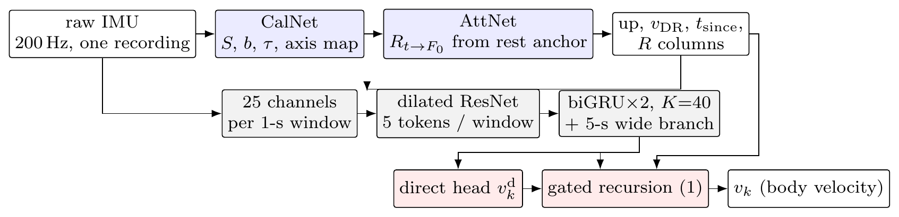

# One small model that estimates the speed of four kinds of robots from an IMU alone

**[English](README.md) | [繁體中文](README.zh-TW.md)** · **One-page summary (PDF): [English](portfolio/onepager_en.pdf) | [中文](portfolio/onepager_zh.pdf)**

**In one paragraph.** An IMU is the small motion sensor (accelerometer plus gyroscope) found in phones and robots. This project estimates how fast a robot is moving using that sensor alone, for a car, a four-legged robot dog, a drone and a handheld rig, with **one set of trained weights and no label telling the model which robot it is looking at**. It is hard because the same sensor reading means different motion on different bodies, and a drone's fast sprint looks nothing like a walking dog.

**Result in the competition.** IROS 2026 TartanIMU Challenge: **20th of 131 on the Kaggle private leaderboard; the organizers subsequently listed our team among the top 10 (organizers' e-mail, 2026-10-09); the official final ranking has not been announced.** The private score is **0.19912** (lower is better; predicting zero velocity everywhere scores 1.0). The organizers' own scoring service, which uses all 89 test sequences, gives **0.25878** for my final competition model (code name `a3v20_s42`). I also joined the organizers' discussion channel for an IMU foundation-model white paper (October 2026); I am not a listed author, and the paper is unpublished.

**The model is small.** 2.17 million parameters (plus 78 thousand in two frozen helper modules), about 1/20 of the 43.7 million-parameter network of a stronger team (thisray). I spent the effort on physically consistent data augmentation, learned sensor-calibration channels and an evaluation setup I could trust, rather than on size. The two official-score improvements these gave (0.0044 and 0.0070) are each within the run-to-run variation you get just from changing the random seed, so they are not independent statistical evidence (see Results).

**My role.** I was the research lead of a one-person Kaggle team: I made the final decision on the research direction, the trade-offs, the validation rules and every submission. AI coding agents (Claude Code, Codex) did the implementation and ran the experiments under my direction. Part of the work is the method for directing them so that no AI marks its own homework: data held out from training, writing down the pass/fail rule before looking at results, a second model recomputing the first one's numbers, and red-team review (an independent model attacks the result). I am the only human author. What is mine and what is borrowed is spelled out in [`docs/post_competition.md`](docs/post_competition.md).

**After the competition (kept separate from the rank).** I took a post-processing method that another team (thisray) released after the challenge and put it on top of my network (Step 1), then added two steps of my own: a ground-robot correction applied at half strength (Step 2) and a per-window uncertainty weight inside the smoothing stage (Step 3). The scores Kaggle returned for late submissions (public / private halves of the test data) went from 0.32793 / 0.19912 for the final competition model to **0.22342 / 0.13903**, about 0.178 on the official full-test scale by my conversion (error about ±0.0005; the competition entry is 0.25878 on that scale). This is **after the deadline, borrows another team's tools, used feedback from the test scores, and carries no rank**; most of the gain comes from the borrowed method. Details, per-step numbers and negative results: [`docs/post_competition.md`](docs/post_competition.md).

**Disclosure about test feedback.** After the competition I also submitted about 89 probe files, each changing one test sequence, to work out which sequences belong to the public half and which to the private half (41 and 48 sequences). I did not use the test values this revealed to adjust any output, but I have not yet asked the organizers whether the method may be described publicly. Full account in [`docs/post_competition.md`](docs/post_competition.md#5-process-and-disclosure).

**What comes next.** I have tried most of the directions I could think of. The next step is to deploy the model on a physical robot and make it a system that works in practice.

<p align="center"></p>

**Links.** [Challenge page](https://superodometry.com/imuchallenge/) (CMU AirLab / Super Odometry Group; official benchmark of the IROS 2026 workshop *Beyond Exteroception*) · [Kaggle competition](https://www.kaggle.com/competitions/tartan-imu-challenge-iros2026) · [my Kaggle profile (20/131)](https://www.kaggle.com/lexhoooo/competitions) · [final standing, team `Lexxxxx`](https://www.kaggle.com/competitions/tartan-imu-challenge-iros2026/leaderboard?search=Lexxxxx) · 🤗 [LexHo/tartanimu-a3v20](https://huggingface.co/LexHo/tartanimu-a3v20) (final competition model: frozen weights, the exact scored `submission.csv`, CPU-reproducible `predict.py`) · 🤗 [LexHo/tartanimu-a3v21](https://huggingface.co/LexHo/tartanimu-a3v21) (second entry) · [technical report (PDF)](report/technical_report.pdf)

Author: Hao-Ting Ho (何浩廷), Department of Electrical Engineering, Tunghai University · lexho2005@gmail.com

<p align="center"></p>

This repository is the curated record of the work: model and training code, the evaluation setups I built, cloud automation, the technical report submitted to the organizers, and a day-by-day account of what was measured, what was decided on it, and where the outcome differed from what I expected.

| | |
|---|---|
| **Result** | Kaggle private leaderboard 20th of 131 (score 0.19912); the organizers subsequently listed our team among the top 10 (organizers' e-mail, 2026-10-09); the official final ranking has not been announced. Official full-test score 0.25878; final competition model `a3v20_s42` |
| **Task** | 3-D velocity (in the robot's own frame) from a 6-axis IMU alone, offline, four robot types, one shared model |
| **Model** | 2.17 M parameters + 78 k in two frozen helper modules; a 1-D convolutional network, a bidirectional recurrent network (GRU) over 40 one-second windows, and a direct velocity output plus a physics-based step that carries velocity from window to window |
| **Scale of work** | about 500 training runs (including failed and diagnostic ones), about 60 thousand logged training epochs, 33 queries to the official scoring service, 26 Kaggle submissions; joined 2026-09-08, delivered 09-21 (about two weeks) |
| **Rules followed** | one checkpoint, no routing to per-robot sub-models, no ensembling, no test-time averaging, no external data in the final model, test labels never used (disclosures: [`docs/canonical_numbers.md §D`](docs/canonical_numbers.md)) |

---

## Results

**[Full results, leaderboard context and honest caveats: `docs/results.md`](docs/results.md)**

Two error measures are used throughout. **AVE** is the velocity error (metres per second). **ATE20** is the trajectory position error (metres). For both, lower is better. The overall score combines them as 0.6·AVE/0.7356 + 0.4·ATE20/3.1160, averaged over the four robot types; predicting zero everywhere scores 1.000, and the organizers' baseline scores 0.538 on the full test.

| Model | Official full-test score ↓ | car ATE20 | human ATE20 | dog ATE20 | drone ATE20 / AVE | four fast-sprint drone sequences, summed AVE (m/s) |
|---|---|---|---|---|---|---|
| Earlier model: windowed CNN + GRU, self-supervised pre-training, time-scaling augmentation | 0.2702 | 0.337 | 0.603 | 0.357 | 1.274 / 0.723 | 15.1 |
| + augmentation that makes drag-consistent faster drone-racing data | 0.2658 | 0.313 | 0.639 | 0.357 | 1.244 / 0.703 | 12.7 |
| **+ learned sensor-calibration channels + gated velocity carry-over: final competition model (`a3v20_s42`)** | **0.2588** | 0.341 | 0.582 | 0.345 | 1.200 / 0.675 | 11.8 |
| Variant: no calibration channels, per-recording conditioning (`a3v21_s42`) | 0.2631 | 0.346 | 0.632 | 0.343 | 1.225 / 0.687 | 12.2 |

**Run-to-run variation matters.** Retraining the same recipe with a different random seed changes the score by an amount comparable to the improvements above: the same recipe with seed 43 scores 0.2693 (seed 42 was designated as the delivery seed before any seed was scored, and turned out to be the favourable side). The pooled standard deviation across seeds is about 0.0056, so the 0.0044 and 0.0070 steps above are each within about 1 standard deviation. All 33 official queries: [`runs/official/`](runs/official/).

### Model releases

| Repository | Entry | Official score | Contents |
|---|---|---|---|
| 🤗 [**LexHo/tartanimu-a3v20**](https://huggingface.co/LexHo/tartanimu-a3v20) | final competition model | **0.25878** | frozen checkpoint, `predict.py`, pinned requirements, the exact scored `submission.csv`, `SHA256SUMS`, compliance declaration |
| 🤗 [**LexHo/tartanimu-a3v21**](https://huggingface.co/LexHo/tartanimu-a3v21) | second entry | 0.26306 | same layout, variant weights |

Each release re-executes from its frozen weights on CPU in about 85 s in an isolated environment (no network, empty cache) and reproduces its scored `submission.csv` to a maximum component difference of 1.9 × 10⁻³ m/s, checked again after re-downloading the published repository.

## What is in the model

- **Input**: dense, randomly offset 1-second windows; 25 channels = raw IMU (6) + a split of the signal about a slowly estimated "up" direction (8) + a rest reference (4) + channels from the learned calibration modules (7).
- **Learned calibration channels** come from two small helper modules stored in the same checkpoint and frozen: `CalNet` (a 64-number summary of the recording, from which it predicts accelerometer scale, bias, a time constant and the gyro-axis mapping) and `AttNet` (integrates the gyro from a rest pose and corrects the orientation with a small GRU). From them: a bounded dead-reckoned velocity, time since the rest pose, and the rotation to the rest-pose frame.
- **Trunk, context, output**: a dilated 1-D ResNet (5 tokens per window) → a bidirectional GRU over 40 windows plus a 5-second low-pass branch → a direct velocity output plus a learned-gain recursion `v_k = ΔR_k v_{k−1} + ΔV_k + K_k (v_direct − v_prop)` that carries velocity from window to window using the IMU increments.
- **Training**: the trunk is first pre-trained by hiding parts of the IMU signal and reconstructing them (released train+val IMU only), then 120 epochs on train+val, last-epoch weights. Augmentation: physically consistent time-scaling `f' = k²(f − g·û) + g·û`; a drag-consistent speed-up scaling `f' = s(f − g·û) + g·û, v' = s·v` applied only to the drone-racing data family; yaw-direction-only augmentation.
- **Inference**: deterministic, offline within one trajectory, no platform label, no ensembling, no test-time averaging, no adaptation, no external data. Overlapping chunks of the model's own predictions are averaged (stride K/2); that is the only averaging.

## Method: how I tried not to fool myself

- **Held-out data.** I set aside recordings that are excluded from all three training stages (the self-supervised pre-training did see their IMU signal, so this is not strictly clean), then used them as the exam. One analysis was voided when the validation set turned out to be something the model had already trained on.
- **Pass/fail rule before submission.** Before each late submission or check I wrote down what would count as success (12 files in the post-competition phase). They are archived by me with no third-party timestamp, and often share a code snapshot (commit) with the result, so I do not claim external verifiability.
- **Another model recomputes.** Codex recomputed the ground-robot analysis independently (match to < 1e-6); Codex also found six bugs in the learned-calibration code.
- **Repeat with other seeds only for finalists.** A result that does nothing on one seed is dropped; extra seeds are used to confirm a candidate (the half-strength ground correction reproduced with two more seeds).
- **Negative results are logged with the number that killed them**: about 50-60 entries in the chronicle, plus the post-competition nulls (test-time averaging, a network that predicts its own uncertainty directly, new ground-robot constraints) in [`docs/post_competition.md`](docs/post_competition.md).
- **Disclosure.** Use of test-score feedback, choices made between candidates, and one discarded branch that touched unlabelled test IMU are listed in [`docs/post_competition.md §5`](docs/post_competition.md) and [`docs/canonical_numbers.md §D`](docs/canonical_numbers.md).

## What I learned

1. **Every evaluation set measures one population.** The released validation split is honest for ordinary drone flights and blind to the four straight-sprint sequences that carry a large share of the drone error; a fold with high rotation and a fold of sprints measure two other populations. A change can win, lose and win on the three at once, and all three are right. I switched from ranking models on these sets to using them as pass/fail gates (threshold = twice the set's run-to-run variation) and stopped reading the public leaderboard.
2. **How you split the data decides what a channel can learn.** Holding out *all* sprints made a rest-reference channel learn the wrong sign; the same channel did nothing on a split that keeps sibling sprints in training.
3. **The models did not read aerodynamic drag.** A counterfactual probe (scale the horizontal acceleration of the two sprint sequences by 0.5 / 1.5) moved predictions by < 0.3 m/s. Time scaling actually *raises* the sprints (drag ∝ k², speed ∝ k); the drag-consistent speed-up augmentation fixes that ratio at 1 and is the first intervention in a long series that moved the sprint error.
4. **Physics inside a regressor helps only where its assumptions hold, and a learned gate cannot recover the assumptions from the signal.** The recursion gain is one knob with one trade-off: gain ≈ 1 reproduces the model without physics, 3 % propagation gives the delivered setting, 12-40 % makes every platform lag in ordinary conditions. A night of ablations on this line is documented as a negative result.
5. **Sensor conventions vary inside one platform.** 239 of 282 training drone recordings have an IMU frame that is "upside down plus a recording-specific yaw offset" relative to the labels; random body-yaw augmentation destroys the other data source. The strongest entries win on ordinary drone flights with 64-second contexts and a smoother that tracks accelerometer bias and gravity: physics in a smoother, not in a forward recursion.

## Documents

| | |
|---|---|
| [`portfolio/`](portfolio/) | one-page summaries (PDF, English and Chinese) |
| [`docs/post_competition.md`](docs/post_competition.md) | the three steps after the competition: Kaggle scores, what is borrowed and what is mine, held-out checks, negative results |
| [`docs/results.md`](docs/results.md) | final standing, leaderboard context, what each step bought, honest caveats, how to verify |
| [`report/technical_report.pdf`](report/technical_report.pdf) | the report submitted to the organizers (IROS workshop template): eight investigations, each as *measured / result / decision / what differed* |
| [`docs/chronicle.md`](docs/chronicle.md) | day-by-day record of the two weeks, architecture evolution, every official query, the negative-results catalogue (about 50-60 entries with the number that killed each), compliance ledger |
| [`docs/workflow_playbook.md`](docs/workflow_playbook.md) | the ten problems that kept recurring, distilled into an eight-layer workflow and a decision tree |
| [`docs/recursion_gain_study.md`](docs/recursion_gain_study.md) | the closing night: the physics-recursion line, card by card, and why it is one knob with one trade-off |
| [`docs/peer_survey.md`](docs/peer_survey.md) | what the other public entries did, and the four specific things the leading entry does that I did not |
| [`docs/canonical_numbers.md`](docs/canonical_numbers.md) | one source of truth for every number quoted in the README, the form and the report |
| [`docs/evidence/`](docs/evidence/) | leaderboard exports, submission history, screenshots |

## Repository layout

```
predict.py, requirements.txt    inference entry point (identical to the HF repos)
unified/                        model, data pipeline, augmentation, helper modules, training scripts
local_eval/                     evaluation sets: official scorer on validation, sprint/rotation folds, label-free probes
runs/official/*.csv             every official scoring-service result (overall / platform / per-sequence)
runs/folds/*.json               the stress-fold definitions
cloud/                          GPU-cloud automation: bootstrap, lane runner, self-stop, result collector
report/                         LaTeX source + PDF of the technical report
portfolio/                      one-page summaries (PDF)
docs/                           results, chronicle, playbook, studies, evidence
```

## Reproduce a submission

```bash
pip install -r requirements.txt
# download weights/tartanimu_a3v20_s42.pt from the HF repo into weights/
python predict.py --data /path/to/tartan-imu-challenge-iros2026 --out submission.csv
```

Training flags of the final competition model are stored in the checkpoint's `args`; the recipe line is in [`docs/canonical_numbers.md`](docs/canonical_numbers.md). Data are not redistributed (competition licence: academic research only). Cite Tartan IMU (Zhao et al., CVPR 2025) and the [challenge page](https://superodometry.com/imuchallenge/) if you build on this.

## Acknowledgements

CMU AirLab / Super Odometry Group for the dataset, the scoring service and the rule clarifications; GPUtw for cloud GPUs. thisray (Ssu-Rui Lee) for the post-processing code used in the post-competition section (Apache-2.0; the small readout weights are CC-BY-NC-4.0, not redistributed here). Implementation and experiment execution were done by AI coding agents (Claude Code, Codex) under my direction; I decided the direction, the validation rules and every submission, and the numbers here were checked against the scored files.

## Licence

Code and documents: MIT. Weights: see the Hugging Face repositories. Dataset: competition licence, not included.
