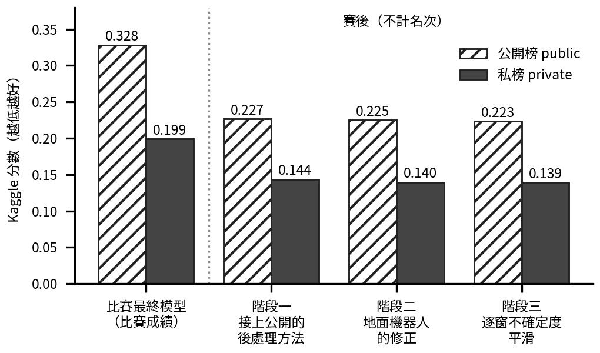
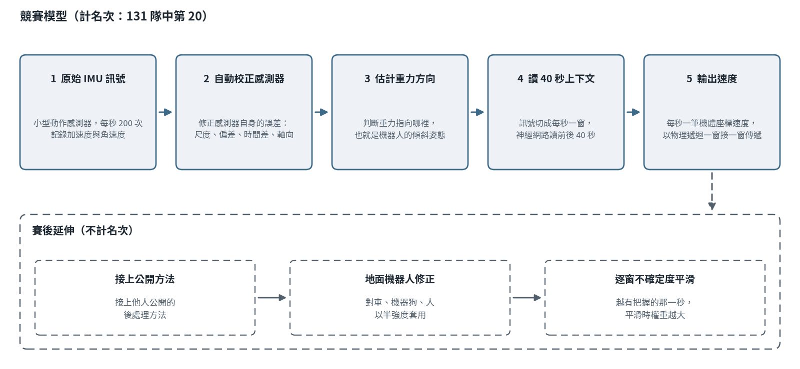

# 一個小模型，只用 IMU 就能估計四種機器人的速度

**[English](README.md) | [繁體中文](README.zh-TW.md)** · **一頁摘要（PDF）：[English](portfolio/onepager_en.pdf) | [中文](portfolio/onepager_zh.pdf)** · **網頁版：[jadiouo.github.io/tartanimu-unified-io](https://jadiouo.github.io/tartanimu-unified-io/)**

**一段話說完。** IMU 是手機和機器人裡常見的小型動作感測器（加速度計加陀螺儀）。這個專案只靠它來估計機器人跑多快，對象是車、四足機器狗、無人機、手持裝置四種載具，而且要求**同一組訓練好的權重處理全部四種，推論時也不告訴模型現在是哪一種**。難處在於同樣的感測器讀數在不同載具上代表不同的運動，無人機的高速衝刺和狗慢慢走路的訊號完全不像。

**比賽成績。** IROS 2026 TartanIMU Challenge：**Kaggle 私榜第 20 名（131 隊）；主辦方後續將本隊列為前十隊伍之一（2026-10-09 主辦方來信），官方最終名次尚未公布。** 私榜分數 **0.19912**（越低越好；全部猜零速度得 1.0）。主辦方自己的計分服務用全部 89 條測試序列計算，我的比賽最終模型（代號 `a3v20_s42`）得 **0.25878**。另外，2026 年 10 月我受主辦方邀請加入 IMU 基礎模型白皮書的討論頻道；我目前未列為作者，白皮書尚未發表。

**模型很小。** 2.17M 參數（另有兩個凍結的輔助模組共 78k），約為較強隊伍（thisray）43.7M 參數網路的 1/20。我把力氣花在物理一致的資料增強、學習式的感測器校正通道，以及一套我信得過的評估方法，而不是加大模型。這些在官方分數上帶來的兩步進步（0.0044、0.0070）各自都落在「只換隨機種子重訓，分數本身就會飄動」的幅度內，所以不是獨立的統計證據（見下方「結果」）。

**我的角色。** 我是單人 Kaggle 隊伍的研究負責人：研究方向、取捨、驗證規則與每一次提交，都由我做最後決定。實作與實驗執行由 AI coding agent（Claude Code、Codex）在我的指揮下完成。這份工作的一部分是怎麼指揮它們，讓 AI 不會自己改自己的考卷：先拿出一部分資料完全不讓模型看、看結果前先寫下怎樣才算有效、讓另一個模型重算第一個模型的數字、紅方審查（另一個模型專門挑錯）。人類作者只有我一人；哪些是我做的、哪些是借用的，見 [`docs/post_competition.md`](docs/post_competition.md)（英文）。

**賽後延伸（與名次分開）。** 另一支參賽隊伍（thisray）賽後公開了一套後處理方法，我把它接到我的網路上（階段一），再加兩步自己的：地面機器人的修正（只套一半強度，階段二）和平滑時依每個視窗的不確定度加權（階段三）。Kaggle 對賽後晚交件回傳的分數（測試資料公開／私有兩半），從比賽最終模型的 0.32793／0.19912 降到 **0.22342／0.13903**；我換算成官方全測口徑約 0.178（誤差約 ±0.0005；比賽提交在同一口徑為 0.25878）。這是**交件截止後、借用他人工具、用了測試分數回饋、沒有名次**的結果，大部分進步來自借來的方法。各階段數字與負結果見 [`docs/post_competition.md`](docs/post_competition.md)（英文）。

**關於測試回饋的揭露。** 賽後我另外提交了約 89 個探針檔，每個只改一條測試序列，用來還原哪些序列屬於公開半邊、哪些屬於私有半邊（41 條與 48 條）。我沒有用這樣量到的測試真值去修正任何輸出，但還沒有問過主辦方這個方法能不能公開描述。完整說明見 [`docs/post_competition.md`](docs/post_competition.md#5-process-and-disclosure)。

**下一步。** 可試的方向我大致都試過了；下一步是把模型部署到實體機器人上，讓它成為真的能運作的系統。

<p align="center"></p>

**連結。** [比賽頁](https://superodometry.com/imuchallenge/)（CMU AirLab／Super Odometry Group，IROS 2026 工作坊 *Beyond Exteroception* 的官方基準）· [Kaggle 比賽](https://www.kaggle.com/competitions/tartan-imu-challenge-iros2026) · [我的 Kaggle 個人檔案（20/131）](https://www.kaggle.com/lexhoooo/competitions) · [最終榜單（隊名 `Lexxxxx`）](https://www.kaggle.com/competitions/tartan-imu-challenge-iros2026/leaderboard?search=Lexxxxx) · 🤗 [LexHo/tartanimu-a3v20](https://huggingface.co/LexHo/tartanimu-a3v20)（比賽最終模型：凍結權重、實際計分的 `submission.csv`、可在 CPU 重現的 `predict.py`）· 🤗 [LexHo/tartanimu-a3v21](https://huggingface.co/LexHo/tartanimu-a3v21)（第二提交）· [技術報告（PDF，英文）](report/technical_report.pdf)

作者：何浩廷（Hao-Ting Ho），東海大學電機工程學系 · lexho2005@gmail.com

<p align="center"></p>

這個 repo 是整件工作的精選紀錄：模型與訓練程式、我自己建的評估方法、雲端自動化、交給主辦方的技術報告，以及逐日紀錄：量了什麼、據此做了什麼決定、結果與預期哪裡不同。

| | |
|---|---|
| **成績** | Kaggle 私榜第 20 名（131 隊，分數 0.19912）；主辦方後續將本隊列為前十隊伍之一（2026-10-09 主辦方來信），官方最終名次尚未公布。官方全測 0.25878；比賽最終模型 `a3v20_s42` |
| **任務** | 只用六軸 IMU，離線估計機器人自身座標系下的三維速度；四種載具共用一個模型 |
| **模型** | 2.17M 參數＋兩個凍結輔助模組 78k；一維卷積網路 → 跨 40 個一秒視窗的雙向 GRU → 直接預測速度，再加一個把速度在視窗之間接力的物理步驟 |
| **工作規模** | 約 500 個訓練 run（含失敗與診斷 run）、約 6 萬個訓練 epoch 紀錄列、33 次官方計分查詢、26 次 Kaggle 提交；9/8 加入、9/21 交件（約兩週） |
| **遵守的規則** | 一份訓練好的權重檔、不依載具切換子模型、無 ensemble、無測試時平均、比賽最終模型未用外部資料、從未使用測試標籤（揭露事項見 [`docs/canonical_numbers.md §D`](docs/canonical_numbers.md)） |

---

## 結果

詳細結果、榜單背景與限制：[`docs/results.md`](docs/results.md)（英文）

全文用兩個誤差指標，越低越好。**AVE** 是速度誤差（公尺／秒）；**ATE20** 是軌跡位置誤差（公尺）。總分 = 0.6·AVE/0.7356 + 0.4·ATE20/3.1160，四種載具取平均；全部猜零為 1.000，主辦方基線在全測為 0.538。

| 模型 | 官方全測分數 ↓ | car ATE20 | human ATE20 | dog ATE20 | drone ATE20／AVE | 無人機四條衝刺的 AVE 總和 |
|---|---|---|---|---|---|---|
| 較早的模型：視窗 CNN＋GRU、自監督預訓練、時間縮放增強 | 0.2702 | 0.337 | 0.603 | 0.357 | 1.274／0.723 | 15.1 |
| ＋讓賽車類無人機資料「依阻力物理一致地變快」的增強 | 0.2658 | 0.313 | 0.639 | 0.357 | 1.244／0.703 | 12.7 |
| **＋學習式感測器校正通道＋門控的速度接力：比賽最終模型（`a3v20_s42`）** | **0.2588** | 0.341 | 0.582 | 0.345 | 1.200／0.675 | 11.8 |
| 變體：無校正通道、每段錄音各自條件化（`a3v21_s42`） | 0.2631 | 0.346 | 0.632 | 0.343 | 1.225／0.687 | 12.2 |

**隨機種子造成的飄動不能忽略。** 同一個配方只換隨機種子重訓，分數的變動幅度就和上面的進步相當：同配方 seed 43 為 0.2693（seed 42 是在任何 seed 打分前就指定的交付 seed，剛好落在較好的一側）。各 seed 合併的標準差約 0.0056，所以上表 0.0044 與 0.0070 兩步各約 1 個標準差。33 次官方查詢全在 [`runs/official/`](runs/official/)。

### 模型釋出

兩個 Hugging Face repo（比賽最終模型與第二提交），內容含凍結權重、`predict.py`、實際計分的 `submission.csv`、`SHA256SUMS`、合規聲明。在隔離環境（封鎖網路、空 cache）於 CPU 約 85 秒即可重現計分檔，最大分量差 1.9×10⁻³ m/s；重新下載後又驗過一次。

## 方法：我怎麼避免騙自己
技術版流程圖：

<p align="center"></p>


- **留出資料。** 先拿出一部分錄製，三個訓練階段都不讓模型看（自監督預訓練見過它們的感測器訊號，所以不是最嚴格），當作考題；有一輪分析在發現驗證集其實是模型訓練過的資料之後整輪作廢。
- **提交前先寫判準。** 賽後每次提交或檢驗之前，先寫下怎樣才算有效（共 12 份）。這些是我自己存檔、沒有第三方時間戳，也常與結果同一次版本紀錄，所以我不宣稱外部可驗證。
- **另一個模型重算。** Codex 獨立重算地面機器人的分析（差異 <1e-6）；Codex 也在學習式校正程式裡找出六個 bug。
- **只有候選才多換幾個種子。** 單一種子沒效果就放棄；多種子用來複驗候選（地面半強度修正在另外兩個種子都重現）。
- **負結果連同殺死它的數字一起記**：逐日紀錄約 50–60 項，加上賽後的測試時平均、讓網路直接預測不確定度、新增地面約束等失敗，見 [`docs/post_competition.md`](docs/post_competition.md)。
- **揭露。** 測試回饋的使用、候選之間的取捨、一條曾碰到未標註測試 IMU 而被排除的分支，列在 [`docs/post_competition.md §5`](docs/post_competition.md) 與 [`docs/canonical_numbers.md §D`](docs/canonical_numbers.md)。

## 我學到的

1. **每組評估資料量的是一個母體。** 官方驗證集對一般無人機飛行是準的，但看不到四條直線衝刺（它們占無人機誤差很大一塊）；高旋轉和衝刺兩組量的是另外兩個母體。同一個改動可能在三組上一贏一輸一贏，三個結果都對。我因此從「用它們排名」改成「用它們當過關門檻」（門檻 = 該組隨機種子飄動幅度的兩倍），也不再看公開榜。
2. **資料怎麼切，決定通道能學到什麼。** 把所有衝刺都留出，會讓靜止參考通道學到錯的正負號；在保留同族衝刺的切法上，同一個通道沒有效果。
3. **模型沒有讀懂空氣阻力。** 反事實探針（把兩條衝刺序列的水平加速度縮放 0.5／1.5）讓預測改變不到 0.3 m/s。時間縮放反而把衝刺拉高；依阻力物理一致的加速增強把比例固定為 1，是一長串嘗試裡第一個動到衝刺誤差的。
4. **物理放進迴歸器，只在假設成立的地方有用，而學習式閘門無法從訊號裡補回假設。** 接力的增益是一個旋鈕、一個取捨：增益約 1 等於沒有物理；3% 傳遞是交付的設定；12–40% 會讓所有平台在一般情況下變遲鈍。這條線的一整晚消融都記為負結果。
5. **同一種載具內的感測器慣例也不一致。** 282 條訓練無人機錄音中有 239 條的 IMU 座標系相對標籤是「上下顛倒加上每條錄音自己的 yaw 偏移」；隨機的機體 yaw 增強會破壞另一個資料來源。最強的隊伍靠 64 秒脈絡與追蹤加速度計偏差和重力的平滑器贏在一般飛行：物理放在平滑器，而不是放在前向遞推。

## 文件

| | |
|---|---|
| [`portfolio/`](portfolio/) | 一頁摘要（PDF，中英） |
| [`docs/post_competition.md`](docs/post_competition.md) | 賽後三個階段：Kaggle 分數、借用與自己做的區分、留出檢驗、負結果（英文） |
| [`docs/results.md`](docs/results.md) | 最終名次、榜單背景、每一步買到什麼、限制、如何查證（英文） |
| [`report/technical_report.pdf`](report/technical_report.pdf) | 交給主辦方的技術報告（IROS 工作坊範本） |
| [`docs/chronicle.md`](docs/chronicle.md) | 兩週逐日紀錄、架構演進、每次官方查詢、負結果目錄、合規紀錄 |
| [`docs/workflow_playbook.md`](docs/workflow_playbook.md) | 反覆出現的十個問題，整理成八層工作流程與決策樹 |
| [`docs/recursion_gain_study.md`](docs/recursion_gain_study.md) | 最後一晚：物理遞推這條線逐張消融卡 |
| [`docs/peer_survey.md`](docs/peer_survey.md) | 其他公開作法，以及領先隊伍做了而我沒做的四件事 |
| [`docs/canonical_numbers.md`](docs/canonical_numbers.md) | README、表單、報告所用數字的唯一來源 |
| [`docs/evidence/`](docs/evidence/) | 榜單匯出、提交紀錄、截圖 |

## 重現

```bash
pip install -r requirements.txt
# 從 HF repo 下載 weights/tartanimu_a3v20_s42.pt 放進 weights/
python predict.py --data /path/to/tartan-imu-challenge-iros2026 --out submission.csv
```

資料集不轉發（比賽授權僅限學術研究）。若使用請引用 Tartan IMU（Zhao et al., CVPR 2025）與[比賽頁](https://superodometry.com/imuchallenge/)。

## 致謝與授權

感謝 CMU AirLab／Super Odometry Group 提供資料集、計分服務與規則說明；GPUtw 提供雲端 GPU；thisray（Ssu-Rui Lee）公開的後處理程式（Apache-2.0；小型 readout 權重為 CC-BY-NC-4.0，本 repo 不轉發）。實作與實驗執行由 AI coding agent（Claude Code、Codex）在我的指揮下完成；方向、驗證規則與每次提交由我決定，文中數字已對照實際計分檔核對。程式與文件：MIT；權重見 Hugging Face；資料集不包含在內。
